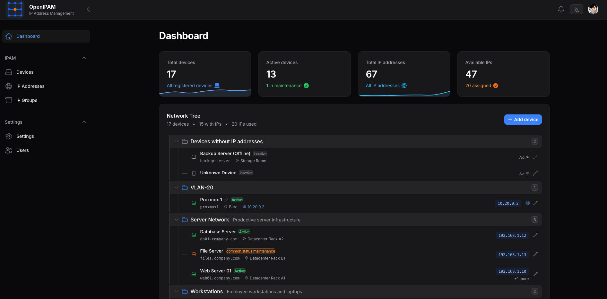

<p align="center">
  
</p>

<h1 align="center">OpenIPAM</h1>

<p align="center">
  <b>Know your network. Find every address.</b><br>
  A self-hosted home for your IP addresses, subnets and devices.
</p>

<p align="center">
  <a href="LICENSE"></a>
  <a href="https://github.com/triopsi/OpenIPAM/actions/workflows/ci.yml"></a>
  <a href="https://github.com/triopsi/OpenIPAM/actions/workflows/release.yml"></a>
  <a href="https://github.com/triopsi/OpenIPAM/releases"></a>
</p>

OpenIPAM helps you keep track of what lives on your network, which addresses are available and how your devices are connected to your address inventory. Built for homelabs and small teams, it brings your network documentation into one searchable place that you host yourself.



[Why OpenIPAM?](#why-openipam) · [Quick start](#quick-start) · [HTTPS & remote access](#https--remote-access) · [Updates & backups](#updates--backups) · [Contributing](CONTRIBUTING.md)

## Why OpenIPAM?

Once a homelab grows beyond a handful of devices, remembering which IP belongs to which machine becomes a project of its own. OpenIPAM gives those details a place to live.

- **Find the next free address.** See available, assigned and reserved IPs, and assign an available address to a device without searching through a spreadsheet.
- **Keep devices and addresses together.** Record hostnames, MAC addresses, device types, locations, descriptions and service URLs. Associate multiple addresses with a device and mark its primary IP.
- **Give your network some structure.** Organize IPv4 and IPv6 addresses into groups, document subnets and VLAN IDs, and create address ranges in bulk.
- **Bring your existing inventory.** Import device lists from CSV with column mapping and export selected devices when you need to share or process them elsewhere.
- **Connect your own tools.** Use the token-based REST API to manage devices, addresses and groups from scripts or other applications.
- **Host it your way.** Start with one container and SQLite, or use MariaDB or PostgreSQL for your database. Keep your inventory on your own infrastructure.
- **Make it comfortable to use.** Choose English or German, personalize your profile and enable email two-factor authentication for browser sign-in.

OpenIPAM is an inventory and address-management tool. It helps you document and manage assignments; it does not replace your DHCP or DNS server.

## Quick start

You need Docker with Compose and a published OpenIPAM image containing the current container setup. No source checkout, local PHP installation or separate database server is required.

> If the updated container image has not been published yet, follow [Building the current source](docs/deployment.md#building-the-current-source) first. Older images may use a different startup procedure.

### 1. Create an installation folder

```sh
mkdir openipam
cd openipam
```

Save the following as `compose.yaml`:

```yaml
services:
  app:
    image: ghcr.io/triopsi/openipam:latest
    restart: unless-stopped
    ports:
      - "127.0.0.1:9080:8080"
    environment:
      APP_URL: http://localhost:9080
      DB_CONNECTION: sqlite
      DB_DATABASE: /var/www/html/storage/database.sqlite
      QUEUE_CONNECTION: sync
      SESSION_SECURE_COOKIE: "false"
      MAIL_MAILER: log
      LOG_CHANNEL: stderr
    volumes:
      - storage:/var/www/html/storage

volumes:
  storage:
```

### 2. Start OpenIPAM

```sh
docker compose up -d --wait
```

### 3. Open the installer

Open [localhost:9080/admin](http://localhost:9080/admin). On a fresh installation, OpenIPAM takes you to the setup form. Enter your name, email address and a password to create the first account and sign in. Once an account exists, the installer closes and later visits show the normal sign-in page.

That's it. The container generates its application key once, keeps it in the `storage` volume, creates the SQLite database and applies pending migrations on every startup. No `.env` file, manual key generation or console-based account creation is needed for this SQLite setup.

This example binds to the host's loopback interface. To open it from another computer or put it behind your homelab's reverse proxy, use the instructions below.

## HTTPS & remote access

For an HTTPS reverse proxy, change these values under `environment`:

```yaml
      APP_URL: https://ipam.example.org
      SESSION_SECURE_COOKIE: "true"
```

Configure the proxy to forward the original host and protocol, and route requests to OpenIPAM's container port `8080`.

- **Proxy on the same host:** keep `127.0.0.1:9080:8080` and proxy to `http://127.0.0.1:9080`.
- **Proxy on another machine:** change the mapping to `9080:8080` and allow access to that host port only from your proxy or trusted network.
- **Proxy in Docker:** connect it to the application's Docker network and proxy to `app:8080`; a published host port is then optional.

For direct HTTP access inside a trusted LAN, use `9080:8080`, set `APP_URL` to `http://YOUR-SERVER-IP:9080` and leave `SESSION_SECURE_COOKIE` set to `"false"`. Then apply your changes:

```sh
docker compose up -d --wait
```

OpenIPAM currently assumes trusted users: API registration is public and authenticated users share access to inventory and user management. Keep it behind a VPN or an access-controlled proxy when reachable outside your trusted network. Browser email 2FA and API tokens are separate authentication mechanisms. See [Security](SECURITY.md) for details.

## Optional configuration

### Email two-factor authentication

Configure SMTP before enabling email 2FA on your profile. Add your provider's settings to the app's `environment` section:

```yaml
      MAIL_MAILER: smtp
      MAIL_SCHEME: smtp
      MAIL_HOST: smtp.example.org
      MAIL_PORT: "587"
      MAIL_USERNAME: ${MAIL_USERNAME}
      MAIL_PASSWORD: ${MAIL_PASSWORD}
      MAIL_FROM_ADDRESS: ipam@example.org
      MAIL_FROM_NAME: OpenIPAM
```

Create an `.env` file next to your Compose file, or extend your existing one, with `MAIL_USERNAME` and `MAIL_PASSWORD`. Use `smtps` when your provider requires implicit TLS, commonly on port 465. Apply changes with `docker compose up -d`.

Without SMTP, the quick-start configuration writes messages to container logs instead of delivering them.

### Choose your database

The quick start uses SQLite: one container, with the database stored alongside uploads and the generated application key. For most small installations, this is the easiest place to start.

<details>
<summary><strong>Use MariaDB instead of SQLite</strong></summary>

For a new MariaDB installation, use this `compose.yaml` instead of the quick-start example:

```yaml
services:
  app:
    image: ghcr.io/triopsi/openipam:latest
    restart: unless-stopped
    ports:
      - "127.0.0.1:9080:8080"
    environment:
      APP_URL: http://localhost:9080
      DB_CONNECTION: mariadb
      DB_HOST: db
      DB_PORT: "3306"
      DB_DATABASE: openipam
      DB_USERNAME: openipam
      DB_PASSWORD: ${DB_PASSWORD:?Set DB_PASSWORD in .env}
      QUEUE_CONNECTION: sync
      SESSION_SECURE_COOKIE: "false"
      MAIL_MAILER: log
      LOG_CHANNEL: stderr
    volumes:
      - storage:/var/www/html/storage
    depends_on:
      db:
        condition: service_healthy
  db:
    image: mariadb:11.4
    restart: unless-stopped
    environment:
      MARIADB_DATABASE: openipam
      MARIADB_USER: openipam
      MARIADB_PASSWORD: ${DB_PASSWORD:?Set DB_PASSWORD in .env}
      MARIADB_RANDOM_ROOT_PASSWORD: "yes"
    volumes:
      - database:/var/lib/mysql
    healthcheck:
      test: ["CMD", "healthcheck.sh", "--connect", "--innodb_initialized"]
      interval: 5s
      timeout: 5s
      retries: 20

volumes:
  storage:
  database:
```

Create an `.env` file next to it containing a strong database password:

```dotenv
DB_PASSWORD=replace-with-a-long-random-password
```

Then run `docker compose up -d --wait` and open [localhost:9080/admin](http://localhost:9080/admin) to create your first account. The app generates and persists its own key and runs migrations automatically after MariaDB is healthy.

Back up both volumes and keep your database password. Changing `DB_PASSWORD` later does not change an existing MariaDB user's password. This example is for a fresh database; switching an existing installation from SQLite to MariaDB does not transfer its inventory.

</details>

The image also supports PostgreSQL. See the [deployment guide](docs/deployment.md) for external database settings. The root `compose.yaml` and `compose.mariadb.yaml` files in the source repository are development environments; use the release image for a homelab installation.

## Updates & backups

Back up your database and storage volume before updating. The generated application key is included in storage; if you supply `APP_KEY` explicitly, back up that value separately. For the SQLite quick start, stop the app while copying storage so the database backup is consistent; a complete command example is in the [backup guide](docs/deployment.md#backup-and-restore).

Update from your installation folder:

```sh
docker compose pull
docker compose up -d --wait --remove-orphans
```

Every container start applies pending migrations automatically before serving requests. Your data and generated application key stay in the named volume. Avoid `docker compose down -v` unless you intend to delete the installation's stored data.

For controlled upgrades, replace `:latest` with a published version tag from [Releases](https://github.com/triopsi/OpenIPAM/releases). Keep the same volumes and application key. If you already use MariaDB or PostgreSQL, keep that database configuration rather than switching to the SQLite example.

**Upgrading from the older OpenIPAM Docker setup?** Keep your existing `APP_KEY` in the app's environment, along with the original database and storage mounts. An explicit key always takes precedence over automatic generation. Existing accounts go straight to sign-in; the installer is available only when the selected database has no users. Remove any obsolete `AUTO_MIGRATE` setting: migrations now run on every start. Do not replace an existing MariaDB data directory with a different database major version without a supported database upgrade or dump/restore. See the [upgrade procedure](docs/deployment.md#upgrade-an-existing-installation) before changing the deployment.

## Account management

From your installation folder:

```sh
# List accounts and find the email address used to sign in.
docker compose exec app php artisan user:list

# Create another account; the password is requested interactively.
docker compose exec app php artisan user:create

# Edit an account, including an optional password reset.
docker compose exec app php artisan user:update user@example.org
```

## Get involved

Found a bug or have an idea? Open an [issue](https://github.com/triopsi/OpenIPAM/issues). Code, documentation, translations and useful bug reports are welcome.

The [contribution guide](CONTRIBUTING.md) explains how to get the development source, run the Devcontainer or Docker environment, test changes and submit a pull request.

| Guide | What you will find |
| --- | --- |
| [Contributing](CONTRIBUTING.md) | Fork, develop, test and submit changes |
| [Development reference](docs/development.md) | Tooling, SSH, ports and project structure |
| [Deployment](docs/deployment.md) | Build from source, upgrades and backups |
| [API reference](docs/api.md) | Authentication, endpoints and examples |
| [Security](SECURITY.md) | Access model and private vulnerability reporting |

OpenIPAM is available under the [MIT license](LICENSE).
